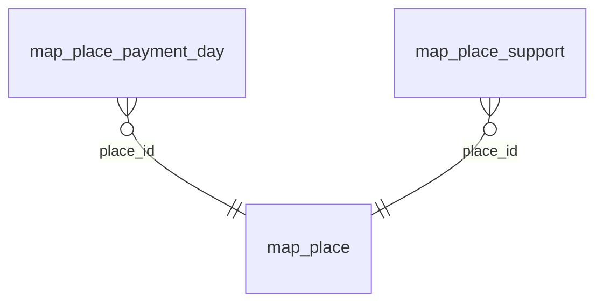

<!-- Generated by integration/db-schema-reference.ts - do not edit. Run: bun run db:docs -->

# `map_place`

Source: [src/lib/map/store.ts](../../../src/lib/map/store.ts)

## Columns

| Column                | Kind                    | Database type | Nullable | Default     | References |
| --------------------- | ----------------------- | ------------- | -------- | ----------- | ---------- |
| `id`                  | Free text (primary key) | `TEXT`        | Yes      | –           | –          |
| `origin`              | Free text               | `TEXT`        | No       | –           | –          |
| `external_id`         | Free text               | `TEXT`        | No       | –           | –          |
| `name`                | Free text               | `TEXT`        | No       | –           | –          |
| `description`         | Free text               | `TEXT`        | Yes      | –           | –          |
| `lat`                 | Decimal                 | `REAL`        | No       | –           | –          |
| `lon`                 | Decimal                 | `REAL`        | No       | –           | –          |
| `category`            | Free text               | `TEXT`        | No       | –           | –          |
| `payment_methods`     | Free text               | `TEXT`        | Yes      | –           | –          |
| `created_at`          | Free text               | `TEXT`        | No       | –           | –          |
| `tech_provider`       | Free text               | `TEXT`        | No       | `DFX.swiss` | –          |
| `country`             | Free text               | `TEXT`        | Yes      | –           | –          |
| `street`              | Free text               | `TEXT`        | Yes      | –           | –          |
| `house_number`        | Free text               | `TEXT`        | Yes      | –           | –          |
| `postal_code`         | Free text               | `TEXT`        | Yes      | –           | –          |
| `city`                | Free text               | `TEXT`        | Yes      | –           | –          |
| `shop_type`           | ENUM                    | `TEXT`        | Yes      | –           | –          |
| `last_transaction_at` | Free text               | `TEXT`        | Yes      | –           | –          |
| `activity`            | ENUM                    | `TEXT`        | No       | `none`      | –          |
| `activity_until`      | Free text               | `TEXT`        | Yes      | –           | –          |

## Indexes

| Columns                 | Unique | Origin            | Partial |
| ----------------------- | ------ | ----------------- | ------- |
| `activity_until`        | No     | index             | No      |
| `country`               | No     | index             | No      |
| `id`                    | Yes    | primary key       | No      |
| `origin`, `external_id` | Yes    | unique constraint | No      |

## Referenced by

| Table                   | Column     | Points to |
| ----------------------- | ---------- | --------- |
| `map_place_payment_day` | `place_id` | `id`      |
| `map_place_support`     | `place_id` | `id`      |

## Relations

