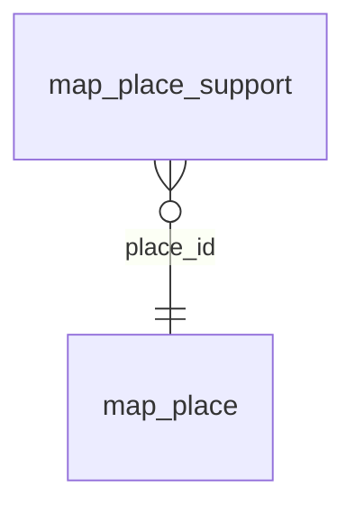

<!-- Generated by integration/db-schema-reference.ts - do not edit. Run: bun run db:docs -->

# `map_place_support`

Source: [src/lib/map/store.ts](../../../src/lib/map/store.ts)

## Columns

| Column       | Kind                    | Database type | Nullable | Default | References                       |
| ------------ | ----------------------- | ------------- | -------- | ------- | -------------------------------- |
| `place_id`   | Free text (primary key) | `TEXT`        | No       | –       | [`map_place`.`id`](map_place.md) |
| `blockchain` | Free text (primary key) | `TEXT`        | No       | –       | –                                |
| `asset`      | Free text (primary key) | `TEXT`        | No       | –       | –                                |

## Indexes

| Columns                           | Unique | Origin      | Partial |
| --------------------------------- | ------ | ----------- | ------- |
| `blockchain`, `asset`, `place_id` | No     | index       | No      |
| `place_id`, `blockchain`, `asset` | Yes    | primary key | No      |

## Referenced by

None.

## Relations

